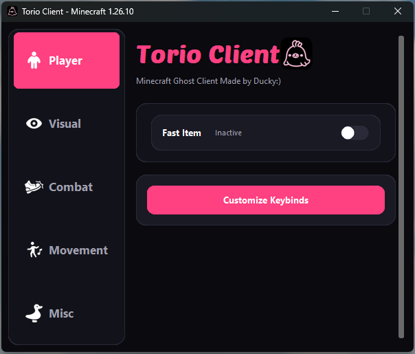
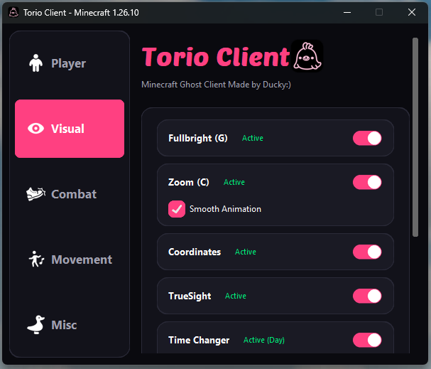
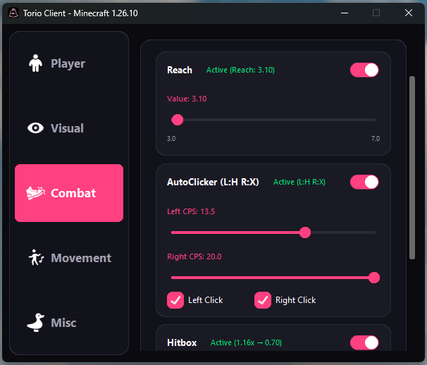
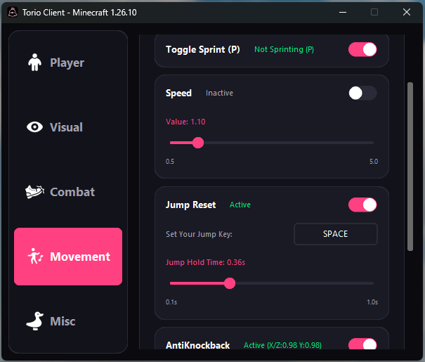
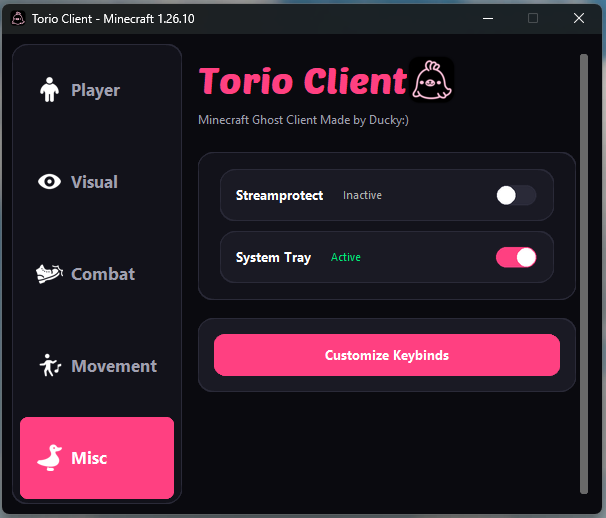

# Torio Client(TorioGhost External)

A lightweight External Ghost Client for **Minecraft Bedrock Edition**  
**Supported Versions: v26.30 – v26.52**

[![downloads][16]][17]

[16]: https://custom-icon-badges.demolab.com/badge/-Download-F25278?logo=download&logoColor=white
[17]: https://github.com/Uncle-Awrt/Torio-Client/releases/download/v2.2.0-beta.1/TorioClient.exe

Torio Client(TorioGhost External) is designed to enhance gameplay with visual modules, movement modules, combat modules, and customizable modules.

  
  
  

> ⚠️ As of v1.2.0-beta.1, TorioGhost External has been migrated from **Python 3.11** to **WPF (C#)** for significantly improved performance and launch speed. Development will now focus exclusively on v26+ updates.

## 🔗 Source Code (C# / WPF)

https://github.com/kukentyan/torio-master-wpf

> Note: The source code is not yet available as a stable version has not been released.

## 📢 Discord

For announcements, support, and feedback, join our official Discord server.

**https://discord.gg/xq8sWQhuXG**

---

## Features (C# / WPF Version)

> **Total Modules: 71** (Visual: 25 | Combat: 18 | Movement: 13 | Utility & Settings: 15)

### Visual Modules

#### Fullbright
Keeps the world fully illuminated at all times.

#### Zoom
Adjustable zoom for clearer long-distance vision, with optional smooth animation.

#### BehindYou
Hold the keybind to instantly switch to the front-facing third-person camera and see what is behind you. Your previous camera returns when you release it.

#### FreeLook
Hold the keybind to rotate your camera freely without changing the direction your character is facing. ESP and Name Tags keep working while you use it.

#### Coordinates
Displays your current XYZ coordinates on screen.

#### ESP
Draws a 2D or 3D box around nearby players, visible through walls. Supports outline, fill with adjustable opacity, line thickness, max distance, Rainbow Mode and a Duck Mode.

#### NameTag
Draws custom name tags above players with their name, distance, held item and armor icons. Friends are shown in green. Font, size and max distance are configurable.

#### Hide & Seek Helper
Detects players who are disguised as blocks in Hide and Seek and highlights where they are hiding.

#### Mongraal Resolution
Stretches your view with separate horizontal and vertical FOV multipliers, like a stretched resolution.

#### Block ESP
Highlights selected blocks through walls, with optional fill, distance labels and tracer lines.

#### Storage ESP
Highlights storage blocks such as chests and barrels through walls, with optional distance labels and tracer lines.

#### Looking Blocks
Outlines the block you are currently looking at, with optional face fill and Rainbow Mode.

#### Tracers
Draws lines from your screen to nearby players. The target point (head, body or feet), line origin, thickness and max distance are configurable.

#### Radar
Shows nearby players on a small radar in a corner of the screen, with configurable size, range and names.

#### Chams
Renders players through walls as a filled model or a skeleton, with optional outline. Can also be shown on yourself in third person.

#### Player Trail
Renders a trail behind you as you move. Supports Line, Breadcrumbs and Poop styles, with glow and Rainbow Mode.

#### Hit Particles
Spawns Stars, Rings or Hearts particles when you hit an entity, with configurable count, size, glow and Rainbow Mode.

#### TrueSight
Makes invisible entities visible (e.g. invisible players and mobs).

#### ViewModel
Brings back 1.7-style first-person animations, including sword blocking when you hold right click with a sword, and the old swing and eating animations.

#### Anti Blindness
Removes the blindness and darkness effects so you can see clearly.

#### Ambience
Changes the in-game time and weather (rain) client-side, with quick presets from Sunrise to Midnight.

#### Duck Overlay
Displays a cute animated duck on your screen to help you stay calm during gameplay.

#### Notifications
Displays in-game notification toasts for client events and module toggles, with configurable size and Rainbow Mode.

#### Custom Watermark
Displays a customizable text watermark on screen with configurable text, font, size, Rainbow Mode and Animated Gradient.

#### Array List
Displays the currently active modules on screen. Supports font, size, glow, Rainbow Mode, Animated Gradient and Connect Lines. It can be moved and resized with the HUD Editor.

---

### Combat Modules

#### Reach and Block Reach
Extends your attack reach (with an optional randomizer) and your block interaction reach (up to 12 blocks).

#### Ghost Hand
Lets you hit players through blocks.

#### AutoClicker (Left & Right)
Automates left and right clicks with separate CPS, a CPS randomizer and jitter. Includes Avoid Menu, Break Blocks, Break With Sword, slot checks and Priming (hold left click to bridge or stop the clicker).

#### Double Clicker
Sends an extra click for every real click, effectively doubling your CPS. Works for left and right click, with a Block Jump Bridge option, Avoid Menu, Break Blocks and slot checks.

#### Hitbox
Expands entity hitboxes for easier targeting, with an optional Shadow Spoof.

#### TriggerBot
Automatically attacks when your crosshair is over a target. Supports **Bedrock** and **Java** modes, **FirstHit only**, **HitSelect** and Auto Click, with a slot check for swords, axes and maces.

#### Auto Mace
Automatically attacks with a mace after you fall a set distance. Can swap to your mace (Any, Density or Breach) and back, with an optional Mace Aim Assist (Silent or Camera aim).

#### Auto Totem
Automatically moves a totem into your offhand from your inventory, with random delays. Options include Only In Inventory Screen, Keep Hotbar Totems and a totem count notification.

#### Refill
Press the keybind to refill your hotbar from your inventory, with random delays and an optional Only In Inventory Screen.

#### Silent Aura
Automatically attacks players in range with silent rotations, so your camera does not move. Range, FOV, CPS and smoothing are configurable, with Only While Attacking, Only Weapon and Through Walls options.

#### Anchor Macro
Automates respawn anchor PvP: places and charges the anchor, then detonates it. Charges, delay and switch-back are configurable, with Anchor Safe options and an optional Anchor Aim Assist.

#### Auto Crystal
Automates end crystal PvP by placing and breaking crystals at a set speed. Options include Hold Right Click to Trigger, Own Placed Obsidian Only, Auto Switch Slots and an optional Crystal Aim Assist.

#### Sticky Aim
Briefly lowers your sensitivity when your crosshair is on an enemy, so your aim sticks to them more easily. Works with swords and axes.

#### Aim Assist
Guides your aim toward nearby **players** only. Includes sensitivity, aim area, range, vertical aim, slot check and an Aim Mode (Mouse Input or Camera Direct).

#### BackTrack
Delays incoming player position packets so you can hit enemies where they were moments ago. Supports **Flow**, **Hold** and **Drop** modes, and can show the player's real position as a Box or Chams.

#### Auto Throw
Press the keybind to quickly throw pearls, snowballs and other throwable items, then switch back to your previous slot.

#### Pearl Aimbot
When you throw an ender pearl, aims it at the nearest player within the configured distance.

#### Auto Bow
Press the keybind to switch to your bow, charge it and fire, then switch back.

> **Friends** — Add players to your friend list (by name or with the middle-click keybind). Friends are ignored by combat modules and shown in green on Name Tags.

---

### Movement Modules

#### Toggle Sprint
Sprint without holding the sprint key.

#### Air Acceleration (Randomizer Support)
Changes how fast you accelerate while in the air.

#### Timer (Randomizer Support)
Changes the game's tick speed.

#### Auto JumpReset
Automatically jumps when you take knockback to reduce it. Chance, FOV, Only When Looking At Player and Water Check are configurable.

#### Auto Block Reset
Automatically places a block under you when you take a hit to reduce knockback. Chance, delay, FOV, range, Water Check, slot switch-back and Restore Aim are configurable.

#### Clutch
Automatically places blocks under you when you walk off an edge or fall, to save you from falling. Clutch Speed and slot switch-back are configurable.

#### Lag Switch
Hold the keybind to freeze ticks and simulate lag.

#### Velocity
Reduces knockback with separate Horizontal (X/Z) and Vertical (Y) multipliers. Also includes **Knockback Tick** and **Delayed Velocity**.

#### NoSlowdown
Removes the slowdown when using items such as food or bows.

#### NoJumpDelay
Removes the delay between jumps, using either the **Memory** or **Legit** mode.

#### AirJump
Lets you jump while in the air.

#### Auto S-Tap
Automatically taps backwards when you are close to an enemy, to keep spacing and manage knockback. Distance and FOV are configurable.

#### W-Tap
Automatically releases and re-presses forward after you hit someone, to reset sprint for extra knockback. Hold time, chance and Only on Target are configurable.

---

### Utility & Settings

#### Client Settings
GUI Sound, Glass Mode (Acrylic Blur), the GUI Show/Hide keybind and **Self Destruct**, which closes the client and cleans up its traces with one button or keybind.

#### Ingame Overlay & External Window Mode
Switch between showing the GUI as an in-game overlay on top of Minecraft or as a separate **External Window**. Overlay Scale, Background Blur and Block In-Game Movement are configurable.

  
  

#### FakeLag
Delays your outgoing movement packets so you appear to lag to other players. Includes Hardstop When Hit and visuals.

#### Blink
Hold the keybind to hold back your outgoing packets, then release them all at once to teleport on the server.

#### Fast Item
Speeds up item use, with an optional Food Only mode.

#### Stream Hide
Hides the client from screen capture and recordings while you stream.

#### Process Disguise
Runs Torio Client under a disguised process name.

#### System Tray
Minimize Torio Client to the system tray and reopen it at any time.

#### Discord Presence
Shows your current menu, server, Minecraft version and client status on Discord.

#### Toggle Sounds
Plays a sound when you toggle modules on or off, with several sound sets to choose from.

#### Device ID Spoofer
Spoofs your Device ID with one click, either on startup or when you join a server.

#### ReachDisplay Spoof
Spoofs the reach number shown by clients such as Flarial Client and Oderso Client.

#### Auto 360
Hold the keybind to spin 360°. Supports Right, Left and Alternate directions with configurable sensitivity.

#### Ore Miner
Automatically aims at and mines the selected ore (Diamond, Ancient Debris, Iron and more) within reach, with Silent or Camera rotation.

#### Media Overlay
Shows the currently playing media and its controls in an overlay, with adjustable scale and a rotating background.

---

### Animations

- **Expandable Module Cards** – Each module can be expanded to reveal its settings and options with a smooth animation.
- **Toggle Switches** – Modules are enabled and disabled with a smooth toggle switch animation.

---

## Customization

### Modern GUI & DropDownClickGUI

### Glass Mode GUI

### HUD Editor
Move and resize HUD elements such as the Array List, Watermark and Notifications directly on screen.

### Keybind Customization
Every module can have its own keybind. The client also reads your in-game Minecraft keybinds automatically.

### Config & Profile System
Create, switch, import and reset config profiles. Useful for switching between setups quickly or backing up your settings.

### A Full Externally Made Cosmetics MOD
Customize your in-game appearance with unique **client-side cosmetics**, including capes, wings, hats, a jetpack, a flame sword and pets, all with a live preview.

---

## Connect, Loading Screen & Built-in Version Switcher

### Connect Screen
When you launch TorioGhost External, the connection screen automatically detects your running Minecraft Bedrock process and checks version compatibility in real time.

### Loading Screen
Once connected, scans game memory and hooks into Minecraft Bedrock smoothly in seconds, ensuring seamless startup without freezing or delays.

### Built-in Version Switcher
TorioGhost External includes a built in **Version Switcher**, allowing you to switch and install supported Minecraft Bedrock versions directly within the client without needing any third-party launchers.

---

# 📦 Archive — Python Version (up to v1.1.0-beta.3)

> The following section is preserved for reference. The Python-based version of Torio-Client is no longer maintained.  
> Last Python release: [v1.1.0-beta.3](https://github.com/Uncle-Awrt/Torio-Client/releases/tag/v1.1.0-beta.3)

## 🔗 Source Code (Python)

https://github.com/kukentyan/torio-master

## Features (Python Version)

### Player Modules
- **Fast Item** – Speeds up item use timers, allowing faster item usage.

### Visual Modules
- **FullBright** – Keeps the world fully illuminated at all times.
- **Zoom** – Adjustable zoom for clearer long-distance vision.
- **Coordinates** – Displays your current XYZ coordinates on screen.
- **No Hurt Cam** – Disables the hurt camera shake effect when taking damage. (1.21.130~1.21.132 Only)
- **TrueSight** – Makes all invisible entities fully visible.
- **TimeChanger** – Allows you to freely change the in-game time client-side.

### Combat Modules
- **Reach** – Extends melee attack distance.
- **AutoClicker (Left & Right)** – Automates left and right clicks for combat and building.
- **Hitbox** – Expands entity hitboxes for easier targeting.
- **Micro Aim** – Automatically fine-tunes your sensitivity when manually aiming at an enemy.
- **Trigger Bot** – Automatically attacks when your crosshair is over a target. Supports two modes: First Hit and Auto Click.
- **Aim Assist** – Helps guide your aim toward nearby targets.

### Movement Modules
- **ToggleSprint** – Sprint without holding the sprint key.
- **Speed** – Increases player movement speed.
- **JumpReset** *(Test Module)* – Automates jump reset timing during combat. (Supports 1.21.132 and v26)
- **AntiKnockback** – Reduces or prevents knockback from attacks.

### Misc Modules
- **Stream Protect** – Hides sensitive or personal information while streaming.
- **SystemTray** – Open the Torio-Client window from the system tray or exit the client.

---

# ⚠️ Disclaimer

Use of this software is at your **own risk**.  
By using Torio-Client, you agree that all actions are taken at your **own risk**.  
The developer is **not responsible** for any issues, penalties, or data loss caused by using this software.  
Please use responsibly and understand the risks before running the program.

---

## 📄 License

This project is licensed under the [Attribution-NonCommercial 4.0 International (CC BY-NC 4.0)](https://github.com/Uncle-Awrt/Torio-Client/blob/main/LICENSE).  
You may share and adapt this project for non-commercial purposes, as long as appropriate credit is given.
